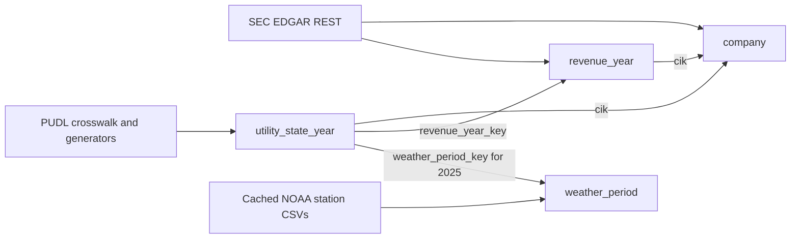

# Create an EDGAR, PUDL, and NOAA Unified Semantic Layer

**Prerequisite:** PUDL registration was re-tested on 2026-10-31 and succeeded. Use [`03_pudl_create.sql`](../../open_data/parquet_csv/sql/03_pudl_create.sql) and confirm the `stable` objects before relying on this walkthrough.


This guide records a model created and queried over JDBC on 2026-10-01. Treat its outputs as historical examples.

Start with [Connecting Codex to Zetaris](../connections/codex-connection.md). Connect and get a row containing `1` from `SELECT 1;` before registering sources or compiling the USL. The connection check does not depend on a sample database already existing.

The model is `lightning.metastore.edgar_pudl_demo.edgar_pudl_noaa_usl`. It links Dominion Energy SEC facts to PUDL generators through a SEC CIK/EIA utility crosswalk, then adds NOAA observations to 2025 state-level generation rows.

Follow these steps in order:

1. [Connect](#1-connect-first-and-establish-execution-scope).
2. [Inspect existing registrations](#2-inspect-existing-registrations-and-choose-a-model-name).
3. [Register missing sources](#3-register-the-required-sources).
4. [Check schemas and join keys](#4-confirm-schemas-and-the-cik-to-utility-match).
5. [Cache NOAA](#5-cache-the-noaa-tables-before-aggregation).
6. [Verify weather coverage](#6-read-the-cached-weather-data-and-assess-its-period).
7. [Compile the USL](#7-compile-and-deploy-all-four-table-definitions-together).
8. [Activate its tables](#8-activate-the-tables-in-dependency-order).
9. [Query the joined result](#9-query-the-activated-usl-and-verify-the-join).
10. [Run DQ separately](#10-run-dq-separately-and-record-its-result).

## What you will create

| USL table | Row grain | Source | Relationships |
|---|---|---|---|
| `company` | One SEC CIK | EDGAR REST | Parent of revenue and utility rows |
| `revenue_year` | CIK and report year | EDGAR REST | `cik` references `company` |
| `weather_period` | One selected station/state for the observed 2025 period | NOAA station CSVs | Referenced by 2025 utility rows |
| `utility_state_year` | Matched CIK, state, and report year | PUDL Parquet | References company, revenue year, and weather period |



The PUDL crosswalk uses probabilistic matching and may contain errors or missing matches. Treat CIK-to-utility links as analytical associations, not proof of ownership. See the [crosswalk documentation](https://data.catalyst.coop/preview/pudl/core_sec10k__assn_sec10k_filers_and_eia_utilities).

The recorded run had 37 observed days per station, **2025-01-01 through 2025-02-06**. This is a partial station series, not a full-year or statewide weather measure; the USL keeps the date range and day count.

## 1. Connect first and establish execution scope

Follow the [connection guide](../connections/codex-connection.md). The driver included in `zetaris-platform` uses these local defaults:

| Setting | Local default |
|---|---|
| Driver JAR, relative to `zetaris-platform` | `jdbc/ndp-jdbc-driver-2.4.3.1-7eff043-driver.jar` |
| Driver class | `com.zetaris.lightning.jdbc.LightningDriver` |
| JDBC URL | `jdbc:zetaris:lightning@localhost:10000` |
| Credentials | Your assigned Zetaris user ID and password |

Use your instance's host and port if they differ. `localhost` is the JDBC client's machine, which may not be the agent's host.

Use Zetaris Lightning SQL through the supplied driver; do not start Spark or create a local `SparkSession`. No application code changes are needed.

Send one SQL statement per JDBC request and wait for completion before dependent statements. Keep the connection open through caching and its queries where possible. Step 7's four-table `COMPILE USL ... DDL` is one payload; do not split on semicolons.

Before SEC registration, replace `YOUR_APP_NAME YOUR_CONTACT_EMAIL` with a real application name and contact email. Do not reuse the database login or put credentials in SQL, source control, or reports.

## 2. Inspect existing registrations and choose a model name

Create only missing objects. Inspect matching existing registrations before proceeding.

```sql
SHOW LIGHTNING DATABASES;
```

For each existing database, inspect its tables:

```sql
SHOW LIGHTNING TABLES SEC_DATA;
```

```sql
SHOW LIGHTNING TABLES PUDL_S3;
```

```sql
SHOW LIGHTNING TABLES NOAA_GHCN_S3;
```

Run table listings only for databases that exist. `SHOW DATASOURCES` does not list all Lightning REST/file databases.

For a fresh model, use the namespace and name shown here. If it exists, inspect it first; `IF NOT EXISTS` does not update it. For a separate version, choose a new name and change it in every compile, activation, and verification statement. Do not remove existing models to run this guide.

## 3. Register the required sources

These are the minimum registrations from the successful run. See the [PUDL](../../open_data/parquet_csv/sql/03_pudl_create.sql), [EDGAR](../../open_data/rest_apis/sql/rate_limited/01_edgar_company_facts_create.sql), and [NOAA](../../open_data/parquet_csv/sql/02_noaa_ghcn_create.sql) scripts. Register only the tables used here.

### 3.1 SEC EDGAR revenue facts

Create the logical database only if absent:

```sql
CREATE LIGHTNING DATABASE SEC_DATA DESCRIBE BY "SEC EDGAR company facts REST source";
```

Register Dominion Energy, CIK `0000715957`, after replacing the SEC User-Agent placeholder:

```sql
CREATE LIGHTNING REST TABLE dominion_revenue_facts FROM SEC_DATA REQUEST(
    endpoint "https://data.sec.gov/api/xbrl/companyconcept/CIK0000715957/us-gaap/Revenues.json",
    method "get",
    response_type "json",
    http_encoding "URLENCODED"
) HEADER (
    user-agent "YOUR_APP_NAME YOUR_CONTACT_EMAIL"
) BODY ();
```

This uses company-wide `us-gaap:Revenues` facts from [SEC EDGAR](https://www.sec.gov/search-filings/edgar-search-assistance/accessing-edgar-data). The response repeats periods across filings; step 8 selects full-year facts and the latest filing per period end.

### 3.2 PUDL utility mapping and generator history

Create the logical database only if absent:

```sql
CREATE LIGHTNING DATABASE PUDL_S3 DESCRIBE BY "Catalyst Cooperative PUDL S3 filestore source";
```

Register the SEC-to-EIA crosswalk:

```sql
CREATE LIGHTNING FILESTORE TABLE pudl_sec10k_utility_matches FROM PUDL_S3 FORMAT PARQUET OPTIONS (
  PATH "s3a://pudl.catalyst.coop/stable/core_sec10k__assn_sec10k_filers_and_eia_utilities.parquet",
  inferSchema "true",
  isS3BucketPublic "true",
  useS3PathStyleAccess "true",
  s3Endpoint "s3.us-west-2.amazonaws.com"
);
```

Register the generator history:

```sql
CREATE LIGHTNING FILESTORE TABLE pudl_eia_yearly_generators FROM PUDL_S3 FORMAT PARQUET OPTIONS (
  PATH "s3a://pudl.catalyst.coop/stable/out_eia__yearly_generators.parquet",
  inferSchema "true",
  isS3BucketPublic "true",
  useS3PathStyleAccess "true",
  s3Endpoint "s3.us-west-2.amazonaws.com"
);
```

The public-bucket path needs no AWS credentials. PUDL's `stable` alias can change; for reproducible results, use a verified release path and inspect its schemas. See [PUDL data access](https://docs.catalyst.coop/pudl/en/stable/data_access.html).

### 3.3 NOAA station histories

Create the logical database only if absent:

```sql
CREATE LIGHTNING DATABASE NOAA_GHCN_S3 DESCRIBE BY "NOAA GHCN-Daily S3 filestore source";
```

Use the three station files below instead of scanning the full `csv/by_year/2025.csv` file. Each station file contains historical data and takes time to load into cache.

```sql
CREATE LIGHTNING FILESTORE TABLE noaa_va_airport FROM NOAA_GHCN_S3 FORMAT CSV OPTIONS (
  PATH "s3a://noaa-ghcn-pds/csv/by_station/USW00013740.csv",
  inferSchema "false",
  header "false",
  isS3BucketPublic "true",
  useS3PathStyleAccess "true",
  s3Endpoint "s3.us-east-1.amazonaws.com"
);
```

```sql
CREATE LIGHTNING FILESTORE TABLE noaa_nc_airport FROM NOAA_GHCN_S3 FORMAT CSV OPTIONS (
  PATH "s3a://noaa-ghcn-pds/csv/by_station/USW00013722.csv",
  inferSchema "false",
  header "false",
  isS3BucketPublic "true",
  useS3PathStyleAccess "true",
  s3Endpoint "s3.us-east-1.amazonaws.com"
);
```

```sql
CREATE LIGHTNING FILESTORE TABLE noaa_sc_airport FROM NOAA_GHCN_S3 FORMAT CSV OPTIONS (
  PATH "s3a://noaa-ghcn-pds/csv/by_station/USW00013880.csv",
  inferSchema "false",
  header "false",
  isS3BucketPublic "true",
  useS3PathStyleAccess "true",
  s3Endpoint "s3.us-east-1.amazonaws.com"
);
```

| State context | Station ID | Station name |
|---|---|---|
| VA | `USW00013740` | Richmond International Airport |
| NC | `USW00013722` | Raleigh Airport |
| SC | `USW00013880` | Charleston International Airport |

These are one-station series per state, not weather at every PUDL plant. The original run checked station IDs and names against the [NOAA inventory](https://www.ncei.noaa.gov/products/land-based-station/global-historical-climatology-network-daily).

## 4. Confirm schemas and the CIK-to-utility match

Inspect each source schema before compiling the USL:

```sql
DESCRIBE DATASOURCE TABLE SEC_DATA.dominion_revenue_facts;
```

```sql
DESCRIBE DATASOURCE TABLE PUDL_S3.pudl_sec10k_utility_matches;
```

```sql
DESCRIBE DATASOURCE TABLE PUDL_S3.pudl_eia_yearly_generators;
```

```sql
DESCRIBE DATASOURCE TABLE NOAA_GHCN_S3.noaa_va_airport;
```

Repeat the NOAA description for `noaa_nc_airport` and `noaa_sc_airport`. The recorded schema exposed `_c0`–`_c7` as strings; activation uses `_c1` for `YYYYMMDD`, `_c2` for element, and `_c3` for value. Adjust if your schema differs. Valid date filtering excludes a header row.

The PUDL crosswalk needs `central_index_key` and `utility_id_eia`. The generator table needs `utility_id_eia`, `report_date`, `state`, `capacity_mw`, and `net_generation_mwh`.

Check the SEC identity as data, not just as an inferred column:

```sql
SELECT cik, entityName FROM SEC_DATA.dominion_revenue_facts;
```

The recorded SEC CIK was numeric `715957`; the USL pads it to `0000715957` to match PUDL's string key. Confirm both company name and CIK before using them as non-null keys.

Confirm the example's match and reporting coverage:

```sql
SELECT m.central_index_key, m.utility_id_eia,
       MAX(g.utility_name_eia) AS utility_name,
       g.report_date, g.state,
       COUNT(*) AS generator_count,
       SUM(g.net_generation_mwh) AS generation_mwh
FROM PUDL_S3.pudl_sec10k_utility_matches m
JOIN PUDL_S3.pudl_eia_yearly_generators g
  ON m.utility_id_eia = g.utility_id_eia
WHERE m.central_index_key = '0000715957'
  AND g.report_date BETWEEN DATE '2023-01-01' AND DATE '2025-12-31'
GROUP BY m.central_index_key, m.utility_id_eia, g.report_date, g.state
ORDER BY g.report_date, g.state;
```

The run matched CIK `0000715957` to EIA utility `5248` and returned nine state/year rows for NC, SC, and VA in 2023–2025. Resolve any different match before treating the foreign keys as valid. PUDL had 2026 rows with missing generation, so this example stops at 2025.

## 5. Cache the NOAA tables before aggregation

Execute each statement separately and wait for completion:

```sql
CACHE TABLE NOAA_GHCN_S3.noaa_va_airport;
```

```sql
CACHE TABLE NOAA_GHCN_S3.noaa_nc_airport;
```

```sql
CACHE TABLE NOAA_GHCN_S3.noaa_sc_airport;
```

All three cache commands completed in the recorded run; the first load took about 107 seconds.

Cache completion does not prove query correctness; run step 6. Persistence across reconnects or restarts is unverified, so treat this as temporary cache, not materialization. Keep the JDBC connection open where possible and reload as needed. `SHOW CACHE TABLES` does not prove explicit-cache membership; see the [SQL companion](zetaris-lightning-sql-companion.md#5-operational-limitations-confirmed-live-not-documentation-guesses).

## 6. Read the cached weather data and assess its period

```sql
SELECT state,
       COUNT(DISTINCT obs_date) AS observed_days,
       MIN(obs_date) AS from_date,
       MAX(obs_date) AS through_date,
       AVG(CASE WHEN element = 'TMAX' THEN CAST(data_value AS DOUBLE)/10.0 END) AS mean_tmax_c,
       AVG(CASE WHEN element = 'TMIN' THEN CAST(data_value AS DOUBLE)/10.0 END) AS mean_tmin_c,
       AVG(CASE WHEN element = 'PRCP' THEN CAST(data_value AS DOUBLE)/10.0 END) AS mean_daily_precip_mm
FROM (
  SELECT 'VA' AS state, _c1 AS obs_date, _c2 AS element, _c3 AS data_value FROM NOAA_GHCN_S3.noaa_va_airport
  UNION ALL
  SELECT 'NC' AS state, _c1 AS obs_date, _c2 AS element, _c3 AS data_value FROM NOAA_GHCN_S3.noaa_nc_airport
  UNION ALL
  SELECT 'SC' AS state, _c1 AS obs_date, _c2 AS element, _c3 AS data_value FROM NOAA_GHCN_S3.noaa_sc_airport
) obs
WHERE obs_date BETWEEN '20250101' AND '20251231'
  AND element IN ('TMAX','TMIN','PRCP')
  AND CAST(data_value AS INT) <> -9999
GROUP BY state
ORDER BY state;
```

The query divides temperatures and precipitation by 10 because NOAA stores tenths of °C and mm. `mean_daily_precip_mm` averages recorded precipitation days; it is not annual total rainfall. The query excludes `-9999` but does not filter other NOAA quality flags.

Observed results from the cached aggregation:

| State | Days | Through date | Mean TMAX °C | Mean TMIN °C | Mean daily precipitation mm |
|---|---:|---|---:|---:|---:|
| NC | 37 | 2025-02-06 | 10.722 | -0.611 | 1.338 |
| SC | 37 | 2025-02-06 | 14.351 | 1.441 | 0.978 |
| VA | 37 | 2025-02-06 | 7.557 | -3.741 | 2.492 |

Check current dates before using `_2025_JANFEB`. If the files cover another period, update the identifier in both weather and utility activations. Do not label a partial period as annual weather.

## 7. Compile and deploy all four table definitions together

Create the namespace if needed:

```sql
CREATE NAMESPACE IF NOT EXISTS lightning.metastore.edgar_pudl_demo;
```

Send this entire block as **one JDBC statement**. The semicolons terminate the embedded table definitions; do not split them into independent top-level requests.

```sql
COMPILE USL IF NOT EXISTS edgar_pudl_noaa_usl DEPLOY NAMESPACE lightning.metastore.edgar_pudl_demo DDL
CREATE TABLE company (
  cik          varchar(10) NOT NULL PRIMARY KEY,
  company_name varchar(200) NOT NULL
);

CREATE TABLE revenue_year (
  revenue_year_key varchar(20) NOT NULL PRIMARY KEY,
  cik              varchar(10) NOT NULL FOREIGN KEY REFERENCES company(cik),
  report_year      integer NOT NULL,
  period_start     date,
  period_end       date,
  revenue_usd      double,
  filing_date      date,
  accession_number varchar(30)
);

CREATE TABLE weather_period (
  weather_period_key      varchar(40) NOT NULL PRIMARY KEY,
  state                   varchar(2) NOT NULL,
  station_id              varchar(11) NOT NULL,
  station_name            varchar(60),
  period_start            date,
  period_end              date,
  observed_days           integer,
  valid_measurement_count integer,
  mean_daily_tmax_c       double,
  mean_daily_tmin_c       double,
  mean_daily_precip_mm    double
);

CREATE TABLE utility_state_year (
  utility_state_year_key varchar(40) NOT NULL PRIMARY KEY,
  cik                   varchar(10) NOT NULL FOREIGN KEY REFERENCES company(cik),
  revenue_year_key      varchar(20) FOREIGN KEY REFERENCES revenue_year(revenue_year_key),
  weather_period_key    varchar(40) FOREIGN KEY REFERENCES weather_period(weather_period_key),
  utility_id_eia        bigint NOT NULL,
  report_year           integer NOT NULL,
  state                 varchar(2) NOT NULL,
  generator_count       integer,
  net_generation_mwh    double,
  installed_capacity_mw double
);
```

Compile/deploy confirms the definitions were accepted, not that activated tables return rows.

## 8. Activate the tables in dependency order

The recorded version activates each source separately and adds cross-source foreign keys. A direct raw SEC/PUDL join hit an internal planning error.

`COALESCE` satisfies the declared `NOT NULL` schema when source expressions are nullable. It does not validate keys. Check CIK, state, and report year; blank keys or zero IDs are not valid records.

### 8.1 Company from SEC

```sql
ACTIVATE USL TABLE lightning.metastore.edgar_pudl_demo.edgar_pudl_noaa_usl.company AS
SELECT
    COALESCE(LPAD(CAST(cik AS STRING), 10, '0'), '') AS cik,
    COALESCE(MAX(entityName), '') AS company_name
FROM SEC_DATA.dominion_revenue_facts
GROUP BY cik;
```

### 8.2 Annual revenue from SEC

```sql
ACTIVATE USL TABLE lightning.metastore.edgar_pudl_demo.edgar_pudl_noaa_usl.revenue_year AS
SELECT
    COALESCE(CONCAT(cik, '_', CAST(report_year AS STRING)), '') AS revenue_year_key,
    COALESCE(cik, '') AS cik,
    COALESCE(report_year, 0) AS report_year,
    period_start,
    period_end,
    revenue_usd,
    filing_date,
    accession_number
FROM (
    SELECT
        LPAD(CAST(cik AS STRING), 10, '0') AS cik,
        YEAR(CAST(fact.`end` AS DATE)) AS report_year,
        CAST(fact.start AS DATE) AS period_start,
        CAST(fact.`end` AS DATE) AS period_end,
        CAST(fact.val AS DOUBLE) AS revenue_usd,
        CAST(fact.filed AS DATE) AS filing_date,
        fact.accn AS accession_number,
        ROW_NUMBER() OVER (
            PARTITION BY fact.`end`
            ORDER BY fact.filed DESC, fact.accn DESC
        ) AS rn
    FROM SEC_DATA.dominion_revenue_facts
    LATERAL VIEW explode(units.USD) AS fact
    WHERE fact.form = '10-K'
      AND fact.fp = 'FY'
      AND DATEDIFF(CAST(fact.`end` AS DATE), CAST(fact.start AS DATE)) BETWEEN 330 AND 400
      AND YEAR(CAST(fact.`end` AS DATE)) BETWEEN 2023 AND 2025
) annual_facts
WHERE rn = 1;
```

`fp = 'FY'` also matches quarterly contexts in annual filings. The duration filter selects full-year facts; the window chooses the latest filing per period end. This example has one company. For multiple companies, partition by CIK and period end. `report_year` uses period-end year; check non-calendar fiscal years against PUDL's calendar year.

### 8.3 Partial weather period from cached NOAA data

```sql
ACTIVATE USL TABLE lightning.metastore.edgar_pudl_demo.edgar_pudl_noaa_usl.weather_period AS
SELECT
    COALESCE(CONCAT(state, '_2025_JANFEB'), '') AS weather_period_key,
    COALESCE(state, '') AS state,
    COALESCE(station_id, '') AS station_id,
    COALESCE(station_name, '') AS station_name,
    CAST(CONCAT(SUBSTR(MIN(obs_date),1,4),'-',SUBSTR(MIN(obs_date),5,2),'-',SUBSTR(MIN(obs_date),7,2)) AS DATE) AS period_start,
    CAST(CONCAT(SUBSTR(MAX(obs_date),1,4),'-',SUBSTR(MAX(obs_date),5,2),'-',SUBSTR(MAX(obs_date),7,2)) AS DATE) AS period_end,
    COUNT(DISTINCT obs_date) AS observed_days,
    COUNT(*) AS valid_measurement_count,
    AVG(CASE WHEN element='TMAX' THEN CAST(data_value AS DOUBLE)/10.0 END) AS mean_daily_tmax_c,
    AVG(CASE WHEN element='TMIN' THEN CAST(data_value AS DOUBLE)/10.0 END) AS mean_daily_tmin_c,
    AVG(CASE WHEN element='PRCP' THEN CAST(data_value AS DOUBLE)/10.0 END) AS mean_daily_precip_mm
FROM (
    SELECT 'VA' AS state, 'USW00013740' AS station_id, 'RICHMOND INTL AP' AS station_name, _c1 AS obs_date, _c2 AS element, _c3 AS data_value FROM NOAA_GHCN_S3.noaa_va_airport
    UNION ALL
    SELECT 'NC' AS state, 'USW00013722' AS station_id, 'RALEIGH AP' AS station_name, _c1 AS obs_date, _c2 AS element, _c3 AS data_value FROM NOAA_GHCN_S3.noaa_nc_airport
    UNION ALL
    SELECT 'SC' AS state, 'USW00013880' AS station_id, 'CHARLESTON INTL AP' AS station_name, _c1 AS obs_date, _c2 AS element, _c3 AS data_value FROM NOAA_GHCN_S3.noaa_sc_airport
) obs
WHERE obs_date BETWEEN '20250101' AND '20251231'
  AND element IN ('TMAX','TMIN','PRCP')
  AND CAST(data_value AS INT) <> -9999
GROUP BY state, station_id, station_name;
```

### 8.4 PUDL generation linked to SEC and weather keys

```sql
ACTIVATE USL TABLE lightning.metastore.edgar_pudl_demo.edgar_pudl_noaa_usl.utility_state_year AS
SELECT
    COALESCE(CONCAT(m.central_index_key, '_', CAST(YEAR(g.report_date) AS STRING), '_', g.state), '') AS utility_state_year_key,
    COALESCE(m.central_index_key, '') AS cik,
    COALESCE(CONCAT(m.central_index_key, '_', CAST(YEAR(g.report_date) AS STRING)), '') AS revenue_year_key,
    CASE WHEN YEAR(g.report_date) = 2025 THEN CONCAT(g.state, '_2025_JANFEB') END AS weather_period_key,
    COALESCE(m.utility_id_eia, 0) AS utility_id_eia,
    COALESCE(YEAR(g.report_date), 0) AS report_year,
    COALESCE(g.state, '') AS state,
    COUNT(*) AS generator_count,
    SUM(g.net_generation_mwh) AS net_generation_mwh,
    SUM(g.capacity_mw) AS installed_capacity_mw
FROM PUDL_S3.pudl_sec10k_utility_matches m
JOIN PUDL_S3.pudl_eia_yearly_generators g
    ON m.utility_id_eia = g.utility_id_eia
WHERE m.central_index_key = '0000715957'
  AND g.report_date BETWEEN DATE '2023-01-01' AND DATE '2025-12-31'
GROUP BY m.central_index_key, m.utility_id_eia, YEAR(g.report_date), g.state;
```

`generator_count` counts source rows at plant/generator/year grain. `SUM(net_generation_mwh)` ignores missing measurements, so the count does not mean every generator reported generation. The weather key is null for 2023–2024 because no weather period is provided for those years.

All four activations returned `registered`. This confirms registration, not successful query execution.

## 9. Query the activated USL and verify the join

First read the weather table:

```sql
SELECT *
FROM lightning.metastore.edgar_pudl_demo.edgar_pudl_noaa_usl.weather_period;
```

The recorded query returned three station/state rows, each with 37 days and 111 valid measurements.

Then run the integrated query:

```sql
SELECT u.report_year, u.state,
       u.generator_count, u.net_generation_mwh, u.installed_capacity_mw,
       r.revenue_usd,
       w.station_id, w.period_start, w.period_end, w.observed_days
FROM lightning.metastore.edgar_pudl_demo.edgar_pudl_noaa_usl.utility_state_year u
JOIN lightning.metastore.edgar_pudl_demo.edgar_pudl_noaa_usl.revenue_year r
  ON u.revenue_year_key = r.revenue_year_key
LEFT JOIN lightning.metastore.edgar_pudl_demo.edgar_pudl_noaa_usl.weather_period w
  ON u.weather_period_key = w.weather_period_key
ORDER BY u.report_year, u.state;
```

The recorded join returned **nine rows**: NC, SC, and VA for 2023–2025. Weather columns were null for 2023–2024 and populated for 2025.

| 2025 state | Generators | Generation MWh | Capacity MW | SEC company revenue USD | Weather station |
|---|---:|---:|---:|---:|---|
| NC | 1 | 147,803 | 79.9 | 16,506,000,000 | `USW00013722` |
| SC | 2 | 108,737 | 79.7 | 16,506,000,000 | `USW00013880` |
| VA | 27 | 1,883,021 | 4,210.4 | 16,506,000,000 | `USW00013740` |

SEC company revenue repeats on every state row; do not sum it across states. The run returned USD 14,393,000,000 for 2023 and USD 14,459,000,000 for 2024. Keep company/year and utility/state/year at separate grains.

These are historical comparison values, not guaranteed outputs from a later PUDL release or SEC filing. Check source tables when results differ.

## 10. Run DQ separately and record its result

Primary and foreign keys generate DQ rules. To run the utility table's checks:

```sql
RUN DQ TABLE lightning.metastore.edgar_pudl_demo.edgar_pudl_noaa_usl.utility_state_year;
```

Wait for rule results before marking DQ passed. The command returned no result within about three minutes and the JDBC client was interrupted. **DQ remains unverified.** The nine-row SELECT is separate evidence.

Use a bounded wait. If you cancel, check whether the server operation stopped; disconnecting a client does not prove cancellation. Do not relaunch DQ while an earlier command may still run.

## Troubleshooting and reruns

| Symptom | What to do |
|---|---|
| Symptom | Action |
|---|---|
| `No suitable driver` for `jdbc:hive2://...` | Use the Zetaris driver class and URL from the connection guide. |
| `Connection refused` | Check the instance and port 10000 from the JDBC client's host. |
| Database or table already exists | Inspect and reuse the object. A slow registration may finish after the client stops waiting. |
| NOAA column not found | Describe the current schema; `_c0`–`_c7` are from the recorded run. |
| NOAA query is slow | Wait for cache completion, use the three station files, and check connection/cache scope. Avoid a full annual scan. |
| `nullable -> NOT NULL` during activation | Check source keys and align the projection with the declared schema; `COALESCE` does not validate them. |
| Activation has an extra or missing column | Match the projection to the DDL. Removing undeclared `utility_name_eia` fixed an earlier mismatch. |
| Raw SEC/PUDL join raises an internal planning error | Use separate source activations and the USL foreign keys shown here. |
| `NoClassDefFoundError` for `USLTable` or `RemoveUSL` | Record the server error and ask the operator. This occurred in the earlier attempt; the later successful read does not explain why. |
| DQ does not return within the wait | Keep the result unverified, record elapsed time, and check whether the operation stopped before retrying. |

This exercise created no USL materialization or durable cache. The earlier `edgar_pudl_energy_usl` remained because its removal command failed in that attempt. Reuse or version existing models; do not remove another user's objects.

## Suggested instruction for an AI agent

For an AI task, attach this and the connection guide and provide credentials through your approved mechanism. After verifying the connection, use this prompt:

```text
Follow the EDGAR/PUDL/NOAA USL guide against the connected Zetaris instance.
Inspect and reuse existing source registrations. Register only missing objects.
Use the Zetaris JDBC driver and Lightning SQL, one statement per request.
Send the complete COMPILE USL DDL block as one payload.
Cache the three NOAA airport station tables before aggregation, then check
their actual date coverage. Keep partial weather periods explicit.
Activate each source separately and connect the USL tables with the documented
CIK/year and weather-period keys. Verify the weather SELECT and joined SELECT.
Treat registered activations, readable rows, and completed DQ as separate outcomes.
Do not edit application code, remove existing models, or claim DQ passed without
rule results. At the end, report the object names, rows returned, weather dates,
commands that failed or timed out, and the steps you took.
```

## Evidence boundary for this guide

The recorded JDBC run returned a row for `SELECT 1`, completed three NOAA cache commands, aggregated three stations, compiled the USL, registered four activations, returned three weather rows, and joined nine rows. DQ did not complete within the bounded wait. No local Spark session or application-code changes were used.

The guide reconstructs that run; it has not been rerun from an empty instance. PUDL registration was re-tested successfully on 2026-10-31, which agrees with this guide's earlier PUDL result.
