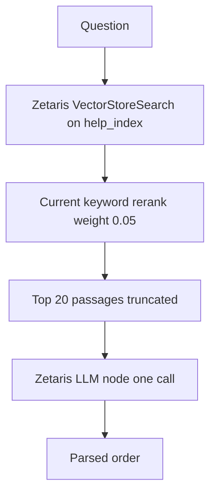

# LLM rerank of search hits

Experimental note. This does not change the keyword rerank, the Search page, or `help_index`. Run the models only after this note is accepted and a run is asked for.

## What this is

Answer mode and Example mode already call the Zetaris `LLM` node. This experiment asks that same node a different question: given the passages a search already returned, put them in a better order. It does not retrieve new pages. A file that never entered the vector top 100 cannot be reranked into the result. The 2.4.1.0 release note is the control for that. On the chunking bake-off it sat around rank 12 to 17 after the keyword rerank, so it is inside the candidate set and a rerank is allowed to move it. `usl-compile` sat at rank 6 or 7 and is the other miss a reorder could fix.

The call is the shape already in [`examples/help-app/core/specs.ts`](../../../../examples/help-app/core/specs.ts): `answerFromTableSpec` builds a `SQLTable` of `prompt`, `content`, and `similarity`, then an `LLM` node with `topN` equal to the batch and `minScore` 0. One call covers the whole batch. The prompt asks for passage numbers, best first, one per line, and nothing else. Each passage is numbered in its header and cut to about 400 characters so a small model can read 20 of them.

## Arms

Same 12 in-scope questions in [`examples/help-app/core/smoke_set.ts`](../../../../examples/help-app/core/smoke_set.ts), one search against the live `help_index`, then three orders of those hits:

1. **Keyword.** Today's rerank in [`examples/help-app/core/rank.ts`](../../../../examples/help-app/core/rank.ts), weight 0.05. No model call. This is the baseline.
2. **Current answer model.** The `LLM` node with `OLLAMA_MODEL` (`gpt-oss:20b` on this machine). This is the quality ceiling and the slow arm.
3. **Small model.** The smallest non-embedding model the configured Ollama already lists via `/api/tags`. Pass that name as `ollamaModelName` on the same node. If the host lists nothing smaller than `gpt-oss:20b`, record that and skip the arm. Do not install a model.

A reply that is not a list of the passage numbers is a failed parse. Score it as a miss for every question it garbles, and keep the keyword order for that question in the latency table so a chatty small model cannot look fast by failing.

## Decision

Score expected-file rank the same way as [`examples/help-app/docs/evidence.md`](../../../../examples/help-app/docs/evidence.md): a hit is the expected file in the top 3 files. Record per-question seconds.

Adopt an arm only if it raises the top-3 hit count by at least two questions, or brings `usl-compile` or `kb-release` into the top 3, without dropping a question that the keyword order already hits. A one-question swing on 12 questions is not enough. The small model is preferred over `gpt-oss:20b` when both meet that bar. Otherwise keep the keyword rerank.

Write the numbers back into this note. Wiring the winner into the Search page is a later change.

## Results (2026-11-13)

One search of the live `help_index` per question, then the keyword order and one `gpt-oss:20b` call per question through the Zetaris `LLM` node. The runner is `deno task help:llm-rerank` in `examples/help-app`. `rank.ts` and the Search page were not changed. Every reply parsed as passage numbers, so no question was scored as a garble.

`GET /api/tags` from this machine returned HTTP 403, so the small-model arm could not be named. It is skipped. No model was installed.

| Question | Keyword file rank | In the top 20 passages | `gpt-oss:20b` file rank | Seconds |
| --- | --- | --- | --- | --- |
| pudl-query | 1 | yes | 1 | 21.0 |
| rest-view | 2 | yes | 1 | 14.5 |
| usl-compile | 7 | yes | 7 | 10.2 |
| company-dns-rate | 1 | yes | 1 | 25.1 |
| known-to-fail | 2 | yes | 1 | 11.6 |
| jdbc-settings | 1 | yes | 1 | 11.3 |
| agents-dry-run | 1 | yes | 2 | 16.0 |
| limit-fragment | 1 | yes | 1 | 24.9 |
| least-privilege | 1 | yes | 1 | 14.5 |
| kb-release | 15 | yes | 12 | 21.6 |
| kb-clone | 1 | yes | 1 | 16.7 |
| kb-s3 | 1 | yes | 6 | 12.6 |

Keyword top-3 hits: 10 of 12. `gpt-oss:20b` top-3 hits: 9 of 12. The twelve calls took about 200 seconds, roughly 17 seconds each. Both misses were already inside the 20 passages, so the model had a chance to move them. `usl-compile` stayed at rank 7. `kb-release` moved from 15 to 12 and stayed outside the top 3. `kb-s3` dropped from rank 1 to rank 6, which is a keyword hit the model lost. The other rank changes (`rest-view` 2 to 1, `known-to-fail` 2 to 1, `agents-dry-run` 1 to 2) stay inside the top 3.

**Decision: keep the keyword rerank.** The model arm did not add two hits, did not bring `usl-compile` or `kb-release` into the top 3, and dropped a question the keyword order already hits. The small-model comparison was not run. Wiring a rerank into the Search page stays a later change, and this run does not justify it.
