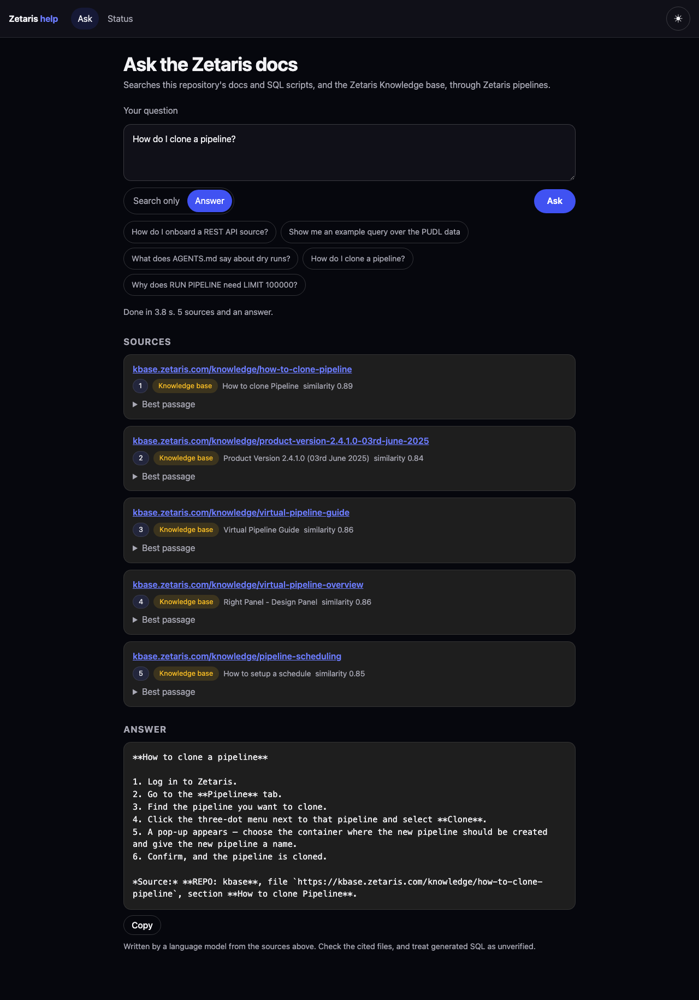

# Help app: a RAG worked example on Zetaris

> **Status:** Phases 1 to 7 of the plan are built; Phase 8 (OpenSearch,
> Spark-only retrieval, incremental re-ingest) is not started. Every "works"
> claim here was run once on one machine (Zetaris Lightning 2.4.3.1, local
> Docker); see [docs/STATUS.md](docs/STATUS.md) for what ran, what did not, and
> the limits. Nothing is hosted: you run it yourself, on your own
> infrastructure.

This example turns the Markdown in this repository into a searchable help index,
and does as much of the work as possible inside Zetaris: the file text goes
through a pipeline of **SQLTable → Chunking → Embedding → VectorStoreSink**, and
a question goes through **VectorStoreSearch** (and, for answers, an LLM node).
The rules and gotchas it relies on are written up in the
[SQL companion guide, section 9](../../docs/guides/zetaris-lightning-sql-companion.md#9-rag-on-zetaris-chunking-embeddings-search-and-answers)
(draft). The guide states the rules; this example shows them in context.

## What you need

| Need              | Detail                                                                                                                                                                                                                                                     |
| ----------------- | ---------------------------------------------------------------------------------------------------------------------------------------------------------------------------------------------------------------------------------------------------------- |
| Zetaris Lightning | A running instance (local or AWS, per the [install guides](../../docs/install)), reachable over REST. The example was tested on Zetaris Lightning 2.4.3.1 in a local Docker deployment.                                                                    |
| Deno              | 2.9 or later (`deno --version`).                                                                                                                                                                                                                           |
| A vector store    | Milvus. [compose/docker-compose.yml](compose/docker-compose.yml) is provided but **has not been run** yet; the example was tested against a Milvus already running locally. About 1 GB of RAM is a reasonable floor for a corpus this size (not measured). |
| Postgres          | 16. [compose/docker-compose.postgres.yml](compose/docker-compose.postgres.yml) starts one on port 5434 (tested: 16.15, arm64, local Docker). It holds the doc and chunk catalogs, the pin log and the candidates.                                          |
| An LLM endpoint   | Only for Answer and Example modes: Ollama, or any server the Zetaris LLM node can reach. Search only needs none.                                                                                                                                           |

The Zetaris containers must be able to reach Milvus (and Ollama). On a single
machine that means `host.docker.internal`, not `localhost`.

**Sizing.** What was measured here: the corpus is 309 files and 2,788 segments
(the repo's Markdown and SQL plus a 171-page Kbase snapshot), and a full ingest
takes about 6 minutes. Models seen on the LLM host used for the tests:
`gpt-oss:20b` 14 GB, `gpt-oss:120b` 65 GB (see
[docs/evidence.md](docs/evidence.md) for what each did). A pilot run (a smaller
corpus) left the Zetaris driver at about 2.2 GiB and Milvus at about 320 MiB;
that is indicative only, and this example's own memory use was not measured.
Search only needs no LLM and answers in about half a second.

## Quick start

The shortest path to a working Ask page (Search only), from a fresh clone. Steps
4 and 5 are only for the Docs, Pinned and Candidates pages.

1. **Settings.** Copy the lines you need from [.env.example](.env.example) into
   the repo root's `.env.local`, and add your Zetaris REST key
   (`ZETARIS_API_KEY`, created in the Zetaris GUI). For a Milvus on this machine
   the defaults work.
2. **Check the prerequisites.** From this folder:
   ```bash
   deno task help:doctor
   ```
   It is read-only. Fix every FAIL line before going on; WARN lines are for
   features you may not use yet.
3. **Install, index, build, start.**
   ```bash
   deno install                   # the app's packages (not needed for the ingest)
   deno task help:ingest          # about 6 minutes: creates the collection and indexes the corpus
   deno task build
   deno task start                # http://127.0.0.1:8000
   ```
   Open it, leave **Search only** selected and ask "How do I onboard a REST API
   source?". Ranked sources should come back in under a second.
4. **Optional: the catalog (Docs, Pinned, Candidates).** Set `HELP_PG_PASSWORD`,
   then start Postgres and build the USL (details in
   [The USL and the data mart](#the-usl-and-the-data-mart)):
   ```bash
   docker compose --env-file ../../.env.local -f compose/docker-compose.postgres.yml up -d
   deno task help:usl
   ```
5. **Optional: Answer and Example modes.** Set `OLLAMA_URL` and `OLLAMA_MODEL`
   (and, if you like, `HELP_EXAMPLE_MODEL`) in `.env.local` and restart the app.
   The URL must be one the Zetaris containers can resolve. The saved
   `help_answer` relation is only registered when `OLLAMA_URL` is set at ingest
   time; the app does not need it.

If something fails, see [Troubleshooting](#troubleshooting).

## What is done in Zetaris and what in the app

| Step                                    | Where                                                                                   |
| --------------------------------------- | --------------------------------------------------------------------------------------- |
| Walk the repo, cut files into segments  | App (`core/corpus.ts`): the Chunking node's header only covers a document's first chunk |
| Chunk guard, embedding, write to Milvus | Zetaris pipeline `SQLTable → Chunking → Embedding → VectorStoreSink`                    |
| Create the Milvus collection            | App, through Milvus's REST API (the sink does not create it)                            |
| Search for a question                   | Zetaris `VectorStoreSearch`, one pipeline run per question                              |
| Re-rank (similarity plus keyword bonus) | App (`core/rank.ts`), because short or code-like questions rank better with it          |
| Write the answer                        | Zetaris LLM node pointed at Ollama; the app picks the passages and the prompt           |
| Check a generated query                 | Zetaris `EXPLAIN`; the app decides the label                                            |
| Doc and chunk catalog, pins, candidates | Postgres rows, read and written through Zetaris (`help_pg`, `help_usl`)                 |
| Pin scoring (likes, uses)               | Zetaris USL `pin_scores`, from the append-only event log                                |
| Rendering, safety checks, pages         | App (Fresh): safe Markdown, same-origin checks, one answer at a time per session        |

## Troubleshooting

- **`Could not find a matching package for 'npm:...'`**: run `deno install`.
- **Doctor says Milvus is unreachable**: check `MILVUS_HOST_URI` (this machine's
  view) and `MILVUS_URI` (the Zetaris containers' view, usually
  `host.docker.internal`).
- **Ingest ends with a count mismatch or "duplicate primary keys"**: see
  [docs/STATUS.md](docs/STATUS.md) and the companion guide, section 9; the sink
  uses the chunk text as its key.
- **Answer or Example fails, Search works**: the LLM host must be reachable from
  the Zetaris containers, not only from your shell.
- **The app shows old code after a change**: `deno task build` again.
- **Candidates fail with "table or view not found"**: run the `CREATE TABLE` and
  `REGISTER DATASOURCE TABLE` step described under Candidates.
- **A pinned or generated result seems wrong**: Answer text and Example SQL are
  written by a language model. Read the cited files.

## Configure

Add the settings in [.env.example](.env.example) to the repo's `.env.local` (the
only env file the repo reads; it is gitignored). The Zetaris settings
(`ZETARIS_REST_URL`, `ZETARIS_API_KEY`, `ZETARIS_ORG_ID`) are the ones the other
scripts already use. No hostnames, tokens or model names are committed.

## Run it

From this folder:

```bash
deno task help:verify --corpus      # walk the repo's Markdown: files, segments, bytes
deno task help:ingest --dry-run     # show exactly what would be sent; changes nothing
deno task help:ingest               # create the collection, ingest, verify, register relations
deno task help:smoke                # 15 curated questions, search only, several keyword weights
```

`help:ingest` drops and recreates only the collection named by
`HELP_COLLECTION`, and refuses to drop a non-empty one without `--yes`. It
always sends `LIMIT 100000` on the sink run: a small `LIMIT` silently writes
only part of the data.

## Run the app

```bash
deno task build     # once, and after code changes
deno task start     # http://127.0.0.1:8000 (HELP_HOST and HELP_PORT change this)
deno task dev       # development server with hot reload instead
```

- **Ask** (`/`): type a question, choose **Search only** (no LLM needed) or
  **Answer**, and read the ranked sources, then the answer. Answer mode needs
  `OLLAMA_URL` and `OLLAMA_MODEL`; without them it is disabled and the page says
  so. Questions that ask for SQL or an example give the model whole script
  files.
- **Status** (`/admin`): connectivity checks (Zetaris, the saved relations,
  `help_usl`, the vector index, the LLM), the last ingest, and the commands to
  re-ingest. `/api/status` returns the same as JSON.
- All Zetaris access is on the server. The browser never sees the API key, the
  SQL or Zetaris's error text. The server logs the mode, the question's length
  and timings, never its text.
- The app has **no login** and binds to `127.0.0.1`. Anyone who can reach it can
  use your Zetaris and LLM, so do not expose it. One Answer request at a time is
  allowed per browser session. Pins and likes carry only the free-text name
  typed into the name field (kept in the browser's local storage). It is not
  verified, so it is a label, not an identity, and a browser can like a pin once
  only because it remembers it did.
- Answers are rendered as Markdown on the server with `marked`. Raw HTML in the
  model's output is shown as text, and links other than http, https, mailto and
  relative ones are dropped, so model output cannot run script.
- **Docs** (`/docs`): the indexed files, grouped by corpus and kind, with a
  filter. A file opens rendered, with the chunks the index holds for it. Only
  files in the `docs` table can be opened (not any path), and Kbase pages come
  from the local snapshot. Source cards on the Ask page link here.
- **Pinned** (`/pins`): answers someone pinned, most liked first. Pin an answer
  with **Pin this answer** on the Ask page. A pin is stored as rows in `help_pg`
  (read through `help_usl`) and embedded in its own Milvus collection
  (`HELP_PINS_COLLECTION`, default `help_pins`). A pin shows a warning when a
  file it cites has changed or is gone since it was pinned. That check compares
  with the `docs` table, which is as current as the last `help:usl` run.
- **Example** (a third mode on the Ask page): describe what you want, for
  example "same as the SIC and EDGAR check, but for companies whose sic is
  7372". The app finds the closest example scripts (whole files, headers kept)
  and guide passages, asks the model for a new example inspired by them, and
  checks any query with Zetaris's own analyzer (`EXPLAIN`, which parses and
  resolves a query and runs nothing). A rejected query goes back to the model
  with the message, up to 3 attempts. The result has one badge: **Generated,
  dry-run passed** or **Generated, unverified** (collapsed, with a warning). It
  never says "verified", and it always lists the files it drew from. Only
  queries (`SELECT` / `WITH`) can be checked; a script with `CREATE` or other
  commands is always unverified. Nothing is run against your data. The model is
  `HELP_EXAMPLE_MODEL`, or `OLLAMA_MODEL` when unset.
- **Candidates** (`/candidates`): generated examples someone chose to save, for
  review. Nothing is added to the repo or published from here. The server works
  out the status again when saving (it never trusts the browser's label) and
  refuses an example with no catalogued source file. Rows live in
  `help_pg.candidates` (see `compose/postgres-init.sql`). On an existing
  Postgres run that one `CREATE TABLE`, then, in Zetaris,
  `REGISTER DATASOURCE TABLE "candidates" FROM
  help_pg` (a table added after
  the datasource was created is not visible until it is registered; `REFRESH`
  does not add it). The Docs page links each file to the candidates that cite
  it.
- **Past answers.** When a question is close to a pinned question (similarity at
  least `HELP_PIN_THRESHOLD`, default 0.82 for the E5 model), a panel above the
  results shows it with its likes. **Use this answer** shows it without calling
  the model. Ranking adds `0.03 * ln(1 + likes)` to the similarity. The
  threshold is loose: questions on the same topic also reach it, so the panel
  shows the question each answer was pinned for.



Screenshots (desktop and phone, Ask and Status) are in
[docs/screenshots](docs/screenshots), taken against a live local stack.

## The USL and the data mart

`deno task help:usl` registers the Postgres database in Zetaris as datasource
`help_pg`, fills its `docs` and `chunks` tables (one row per file and per
segment, written through Zetaris `INSERT`), then builds `help_usl` and
`help_mart` from the numbered scripts in [sql/](sql/). Start Postgres first:

```bash
docker compose --env-file ../../.env.local -f compose/docker-compose.postgres.yml up -d
deno task help:usl --dry-run   # the steps; sends nothing
deno task help:usl             # add --rebuild to drop and recompile help_usl
```

Set `HELP_PG_PASSWORD` (your own choice) in `.env.local` first; the other
`HELP_PG_*` settings are in [.env.example](.env.example). The password only
travels in the datasource statement and is never printed.

| USL table                          | Over                                    | Note                                                                                  |
| ---------------------------------- | --------------------------------------- | ------------------------------------------------------------------------------------- |
| `docs`                             | `help_pg.docs`                          | one row per file: path, corpus, title, kind, bytes, git_sha, chunk_count              |
| `chunks`                           | `help_pg.chunks`                        | one row per segment; `path` is a foreign key to `docs.path`                           |
| `search`                           | relation `help_app.help_search`         | a fixed question, 100 rows; a `SELECT` runs the search pipeline                       |
| `answers`                          | relation `help_app.help_answer`         | a fixed question; **a `SELECT` calls the LLM every time**. Do not join it to anything |
| `pins`, `pin_events`, `pin_scores` | `help_pg.pins` and `help_pg.pin_events` | written by the Pinned feature; empty until something is pinned                        |

Three queries to try in the Zetaris UI (the namespace is
`lightning.metastore.help_app_usl.help_usl`):

```sql
-- how much of each corpus is indexed
SELECT d.corpus, count(*) AS chunks
FROM lightning.metastore.help_app_usl.help_usl.chunks c
JOIN lightning.metastore.help_app_usl.help_usl.docs d ON d.path = c.path
GROUP BY d.corpus
```

```sql
-- the doc catalog by kind, through the data mart
SELECT kind, count(*) AS n FROM help_mart.doc_catalog GROUP BY kind ORDER BY n DESC
```

```sql
-- which files have the most segments
SELECT path, chunk_count FROM help_mart.doc_catalog ORDER BY chunk_count DESC LIMIT 10
```

Things to know:

- Zetaris `INSERT` only appends, so `help:usl` fills the catalog **once**. To
  refill after the corpus changes, run `TRUNCATE docs, chunks` in Postgres and
  run it again.
- The catalog is the corpus as the script walks it now. The Milvus index is only
  as current as the last `help:ingest`, so the two can differ until you
  re-ingest.
- These scripts are not in `open_data/manifest.json`: its `usl` kind runs
  scripts over REST alone, and these need a Postgres datasource created with a
  password and a filled catalog first.

## How it works

1. **Walk.** Every `*.md` and `*.sql` in the repo, skipping dot directories,
   `node_modules`, and the top-level `dist`, `site`, `tmp` and `reports`
   folders, plus this example's own `corpus/` and `docs/`.
2. **Segment in the app, not the pipeline.** Each file is cut at headings into
   segments of about 1,000 characters (code blocks kept whole where they fit).
   The Chunking node only acts as a guard (1,500 characters), because it writes
   its `REPO/FILE/…` header only on a document's first chunk. Giving every
   segment its own `repo`, `file`, `part` and `section` columns means every
   chunk carries provenance.
3. **Send as SQL.** Each segment becomes a `select` with base64-encoded values,
   so quotes and newlines in the Markdown cannot break the statement.
4. **Embed and store in Zetaris.** The Embedding node uses an in-engine model
   (default `e5-small-v2`, 384 dimensions). The Milvus collection is created by
   the script through Milvus's REST API, because the sink does not create it.
5. **Search.** `RUN PIPELINE ON 'vs_search'` with the question inside the spec.
   A saved relation `help_search` is also registered, but its question is fixed,
   and `SELECT` on a relation runs the whole pipeline.

## Tests

```bash
deno task test    # unit tests, no Zetaris needed
deno task check   # fmt, lint, type check
cd e2e && npm install && npm test   # Playwright; builds the app and runs it against a mock Zetaris
```

The e2e suite needs no live stack: it starts a small mock of Zetaris, Milvus and
Ollama and three copies of the app (everything configured, no LLM, Zetaris
unreachable). It needs Node 20 or later and Playwright's Chromium
(`npx playwright install chromium`).

## Tags used in this folder

Claims are marked as in the companion guide: **[C]** repeated, **[S]** one run,
**[U]** untested. "Verified" is reserved for statements that ran on a live
instance, per [CONTRIBUTING.md](../../CONTRIBUTING.md).
