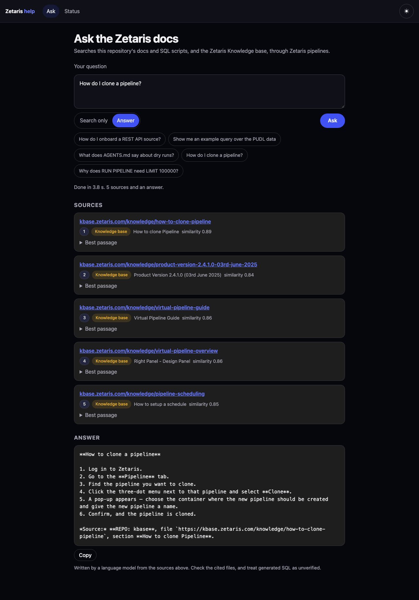
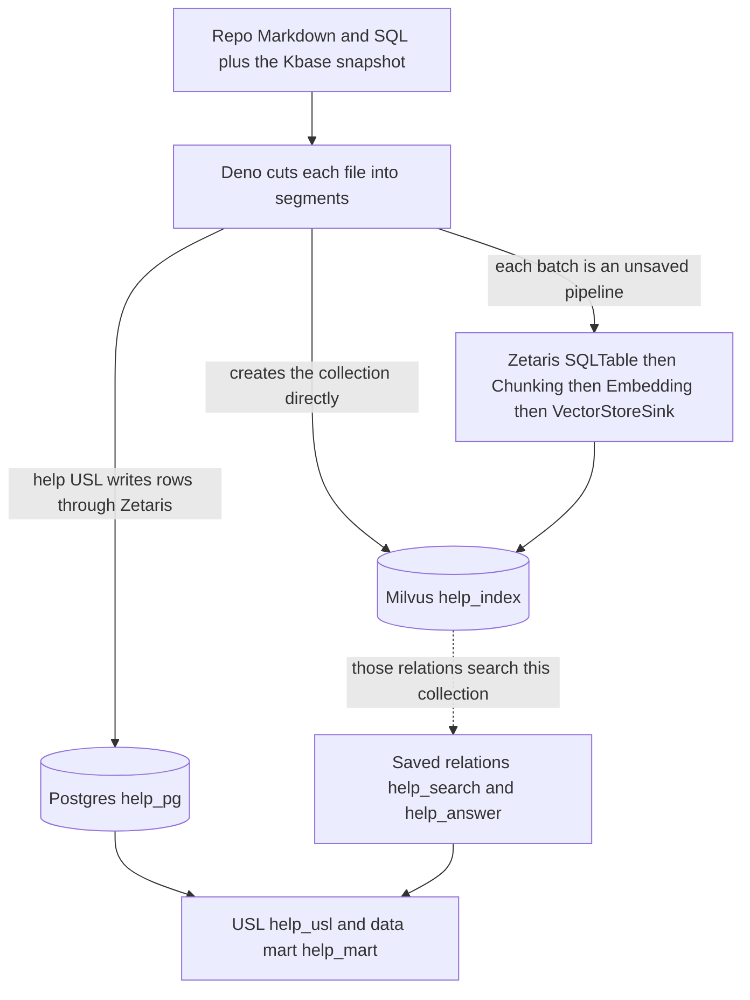
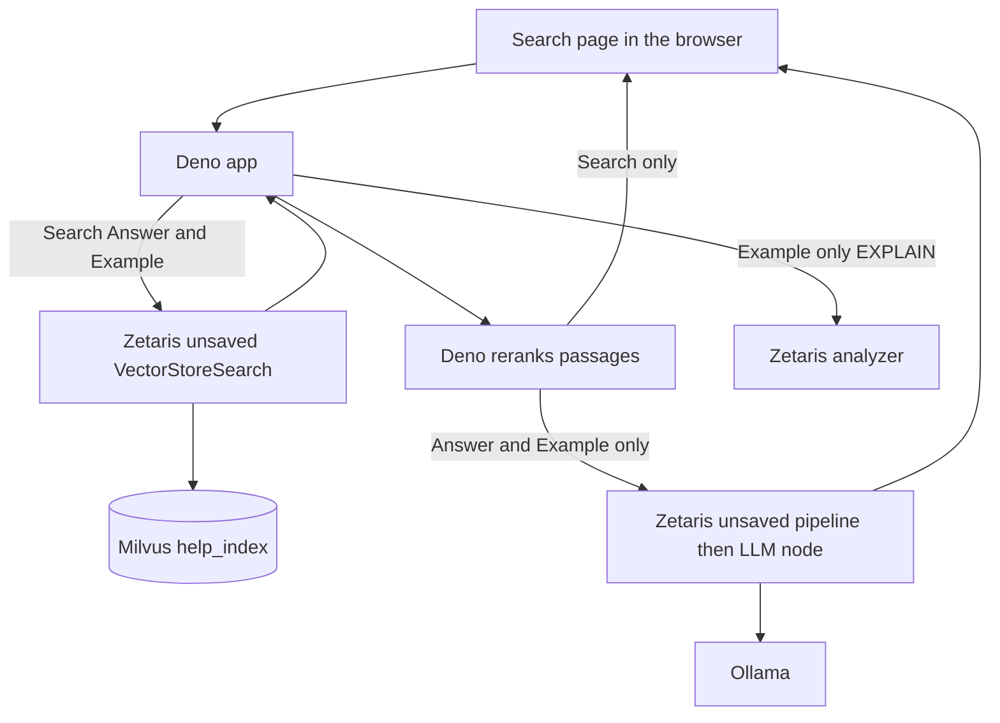

# Help app: a RAG worked example on Zetaris

> **Status:** Phases 1 to 7 of the plan are built; Phase 8 (OpenSearch,
> Spark-only retrieval, incremental re-ingest) is not started. Every "works"
> claim here was run once on one machine (Zetaris Lightning 2.4.3.1, local
> Docker); see [docs/STATUS.md](docs/STATUS.md) for what ran, what did not, and
> the limits. Nothing is hosted: you run it yourself, on your own
> infrastructure.

This example turns the Markdown in this repository into a searchable help index,
and does as much of the work as possible inside Zetaris: the file text goes
through a pipeline of **SQLTable → Chunking → Embedding → VectorStoreSink**, and
a question goes through **VectorStoreSearch** (and, for answers, an LLM node).
The rules and gotchas it relies on are written up in the
[SQL companion guide, section 9](../../docs/guides/zetaris-lightning-sql-companion.md#9-rag-on-zetaris-chunking-embeddings-search-and-answers)
(draft). The guide states the rules; this example shows them in context.

## What you need

| Need              | Detail                                                                                                                                                                                                                                                     |
| ----------------- | ---------------------------------------------------------------------------------------------------------------------------------------------------------------------------------------------------------------------------------------------------------- |
| Zetaris Lightning | A running instance (local or AWS, per the [install guides](../../docs/install)), reachable over REST. The example was tested on Zetaris Lightning 2.4.3.1 in a local Docker deployment.                                                                    |
| Deno              | 2.9 or later (`deno --version`).                                                                                                                                                                                                                           |
| A vector store    | Milvus, started by [compose/docker-compose.yml](compose/docker-compose.yml) on port 19531. Set `MILVUS_IMAGE_TAG` to a release you have tested. About 1 GB of RAM is a reasonable floor for a corpus this size (not measured). |
| Postgres          | 16, the same compose file, on port 5434 (tested: 16.15, arm64, local Docker). It holds the doc and chunk catalogs, the pin log, the search and example logs, and the candidates. |
| An LLM endpoint   | Only for Answer and Example modes: Ollama, or any server the Zetaris LLM node can reach. Search only needs none.                                                                                                                                           |

The Zetaris containers must be able to reach Milvus (and Ollama). On a single
machine that means `host.docker.internal`, not `localhost`.

The container runtime can be Colima in Docker compatibility mode. `docker compose`
is the same command. Memory and CPUs are whatever the virtual machine was given,
not the Mac's RAM. Colima's default (2 GB, 2 CPUs) only fits the help Postgres.
Before starting Zetaris and this Compose file, give the VM 16 GB and 6 CPUs
(`colima start --cpu 6 --memory 16`). Use 24 GB if the Zetaris bundle is on its
server profile (4 GB driver, 4 cores, API heap 2 GB). The install guide's 8 GB
is for Zetaris alone. Its preflight still fails below 6 GB.

Milvus (`MILVUS_URI`, port 19531), the help Postgres (`HELP_PG_HOST`, port 5434),
and `ZETARIS_REST_URL` stay `host.docker.internal`, because those processes are
on this Mac. `OLLAMA_URL` is the other machine's address, the one that already
answers from this Mac. It is not `host.docker.internal`. The Zetaris containers
call it for answers, and the help container calls `GET /api/tags` for the Status
page. A `.lan` name that works in a shell often does not resolve inside the VM;
use the IP if a container cannot resolve it. Confirm from a Zetaris container
that `host.docker.internal` resolves and that ports 19531 and 5434 open. Colima
does not always inject that name, and this Compose file publishes those ports
on `127.0.0.1` only.

**Sizing.** What was measured here: the corpus is 309 files and 2,788 segments
(the repo's Markdown and SQL plus a 171-page Kbase snapshot), and a full ingest
takes about 6 minutes. Models seen on the LLM host used for the tests:
`gpt-oss:20b` 14 GB, `gpt-oss:120b` 65 GB (see
[docs/evidence.md](docs/evidence.md) for what each did). A pilot run (a smaller
corpus) left the Zetaris driver at about 2.2 GiB and Milvus at about 320 MiB;
that is indicative only, and this example's own memory use was not measured.
Search only needs no LLM and answers in about half a second. Nobody has run a
load test. The session counts below are a theory from that half-second search
and from one Zetaris job at a time. The Ollama hosts are already set for
several generations at once.

On this install, expect on the order of ten concurrent readers using Search.
Answer and Example can run several at once on the model host, and then wait
on the single Zetaris driver. That is not a measured maximum.

Search does not take the in-flight lock. One question is one Zetaris
`VectorStoreSearch`, about half a second, and the result is still at most 100
passages. The running driver is one Spark process in `local[2]`: 2 GB of heap
and 2 cores (`ZSPARK_DRIVER_MEM`, `ZSPARK_DRIVER_CORES`, `ZSPARK_MASTER_URL`).
Spark's scheduler gives that job both cores, so a second search waits. A
person who searches and then reads holds the driver only for that half second,
so one job at a time still covers on the order of ten to twenty active
readers. Two people who click at the same moment queue for about half a
second each. An answer holds the same driver for the whole generation, so
searches wait behind it.

Answer and Example take the in-flight lock in `core/limit.ts`: one model call
per browser session, and one per agent id on `POST /api/mcp`. Different
sessions can be in flight together. The call sits inside Zetaris for tens of
seconds (about 45 s on this hardware). Example may do that up to three times.
The two Ollama machines are already tuned for that, from the RAM tier applied
when the daemon was installed. A 64 GB machine gets 4 parallel requests, 3
models loaded, and a 32,768 context. A 128 GB machine gets 8 parallel
requests, 4 models loaded, and the model's own context instead of a cap.
Those are server settings. A direct call to `/api/chat` or `/api/generate`
can pass `options.num_ctx` and use a shorter window than that cap, which is
what changes the KV cache for that request. The parallel count stays the
server's. The help app does not send `num_ctx`. The Zetaris LLM node is only
given `OLLAMA_URL` and the model name, so an answer uses the server's slots
and the server's context.

Parallel slots do not copy the weights. They reserve more context. The
weights measured here are `gpt-oss:20b` at 14 GB and `gpt-oss:120b` at 65 GB.
On the 128 GB M4 Max Mac Studio the 20b model fits inside the 8-wide setting,
and the 120b model fits once, with the leftover RAM as context for those
slots rather than a second copy of the 65 GB. On the 64 GB M4 Pro Mac mini
the 20b model fits inside the 4-wide, 32,768 setting. The 120b model does not
fit in 64 GB. `ollama ps` is the check that a loaded model stayed fully on
the GPU. If it spills, every request gets slower. KV cache grows with the
context actually sent, so one request that fills a native context on the
128 GB machine can push another resident model out.

The help app process is not the ceiling. It keeps no session store except
that in-memory lock, which belongs to one process and resets on restart.
More app containers add no search capacity. They matter once Zetaris and the
model can do more than one thing at once.

Three ways the stack grows:

1. **A larger Zetaris, or more nodes.** This install is already the slim
   laptop profile: the API heap is capped at 1 GB (`ZETARIS_API_MAX_HEAP`),
   and the driver is 2 GB and 2 cores. The shipped server profile is 4 GB and
   4 cores (`local[4]`), which makes one search faster. It does not by itself
   run two searches at once, because `local[n]` is one process and the
   scheduler still hands the running job all of its cores. Heap and cores are
   set in the driver environment. `spark.driver.memory` in
   `spark-defaults.conf` is ignored, because the launch command wins. The
   file that does apply is the shuffle partition count, which should sit near
   the core count, and `spark.scheduler.mode` set to `FAIR` if a short search
   should run beside a long answer. Neither change has been tried here.
   Several searches at once, on the order of ten slots and about a hundred
   active Search readers, means more than one driver, or a cluster master
   instead of `local[n]`. Each answer still occupies a slot for the whole
   generation. Ingest stays a separate, heavy job (`LIMIT 100000`, a full
   rebuild) and should stay off the driver that is serving questions.
2. **The Ollama hosts are already the parallel tier.** Four generations at a
   time on the 64 GB machine, eight on the 128 GB machine. That removes
   Ollama as the limit until more sessions than that are waiting, or until a
   long context fills the KV cache and evicts a model. Past that, point
   `OLLAMA_URL` at an OpenAI-compatible endpoint that scales on its own. The
   app never calls the model for a search. The in-flight lock still allows
   one generation per session. Search capacity stays the same. The status
   page checks the model with `GET /api/tags`. A new endpoint needs that same
   shape, or the status line stays a warning.
3. **Iceberg on S3 instead of Postgres, queried through Zetaris.** Postgres
   here is small: the doc and chunk catalog (about 300 files and under 3,000
   segments), pins, and the append-only search and example logs. Those rows
   are already flattened for a date-prefixed Parquet export
   (`help:export-pins`). Iceberg fits that export and a periodic copy of the
   catalog. It fits poorly as the live store behind a click. A pin, a like,
   and a search log are single-row inserts, and a Docs page reads the catalog
   while someone is waiting. A Spark planning step is a large cost for that.
   Milvus remains the search index either way. Iceberg does not answer a
   question. Keep Iceberg as the review and archive path that already exists,
   and keep Postgres for the interactive writes. A live Iceberg catalog is
   worth another look only when catalog reads may take seconds and writes are
   batched.

## Quick start

The shortest path to a working Search page (Search only), from a fresh clone.
Zetaris and Ollama stay separate installs. Install and start Zetaris, using the
[install guides](../../docs/install), before step 3, with the container VM sized
as above. On a machine with room, set the Zetaris bundle's server profile
(4 GB driver, 4 cores, API heap 2 GB) before the first start. `local[4]` still
runs one job at a time; that limit is in the sizing notes above. Step 4 is the
catalog.

1. **Settings.** Copy the lines you need from [.env.example](.env.example) into
   the repo root's `.env.local`, and add your Zetaris REST key
   (`ZETARIS_API_KEY`, created in the Zetaris GUI). Set `MILVUS_IMAGE_TAG` and
   `HELP_PG_PASSWORD`. `ZETARIS_REST_URL` must use `host.docker.internal` and
   the port Zetaris publishes, not `localhost`: the help container is a
   different machine from Zetaris.
2. **Build, then start Postgres, Milvus, and the app.** From this folder:
   ```bash
   deno install
   deno task build
   docker compose --env-file ../../.env.local -f compose/docker-compose.yml up -d
   ```
   The site is http://127.0.0.1:8000. The container serves the `_fresh` build
   from the repo mount, so build on the host again after app changes and
   recreate the help container. Ingest does not run at startup.
3. **Index.** On the host, about 6 minutes. A new machine has an empty Milvus
   and an empty Postgres volume. `help:ingest` builds the index. Nothing copies
   the old catalog. Docs and pins need step 4 after that.
   ```bash
   deno task help:ingest
   ```
   Open the site, leave **Search only** selected and ask "How do I onboard a
   REST API source?". Ranked sources should come back in under a second.
   `deno task help:doctor` is read-only and reports what is still missing.
4. **Optional: the catalog (Docs, Pinned, Candidates).** Postgres is already
   up. Build the USL (details in
   [The USL and the data mart](#the-usl-and-the-data-mart)):
   ```bash
   deno task help:usl
   ```
5. **Optional: Answer and Example modes.** Set `OLLAMA_URL` to the other
   machine's address, and set `OLLAMA_MODEL` (and, if you like,
   `HELP_EXAMPLE_MODEL`) in `.env.local`. Set the URL before ingest when you
   want the saved `help_answer` relation; that relation is registered only
   when `OLLAMA_URL` is set at ingest time, and the app does not need it.
   Recreate the help container after the URL is set. The URL must be one the
   Zetaris containers and the help container can resolve.

If something fails, see [Troubleshooting](#troubleshooting).

## What is done in Zetaris and what in the app

| Step                                    | Where                                                                                   |
| --------------------------------------- | --------------------------------------------------------------------------------------- |
| Walk the repo, cut files into segments  | App (`core/corpus.ts`): the Chunking node's header only covers a document's first chunk |
| Chunk guard, embedding, write to Milvus | Zetaris pipeline `SQLTable → Chunking → Embedding → VectorStoreSink`                    |
| Create the Milvus collection            | App, through Milvus's REST API (the sink does not create it)                            |
| Search for a question                   | Zetaris `VectorStoreSearch`, one pipeline run per question                              |
| Re-rank (similarity plus keyword bonus) | App (`core/rank.ts`), because short or code-like questions rank better with it          |
| Write the answer                        | Zetaris LLM node pointed at Ollama; the app picks the passages and the prompt           |
| Check a generated query                 | Zetaris `EXPLAIN`; the app decides the label                                            |
| Doc and chunk catalog, pins, candidates | Postgres rows, read and written through Zetaris (`help_pg`, `help_usl`)                 |
| Pin scoring (likes, uses)               | Zetaris USL `pin_scores`, from the append-only event log                                |
| Activity log                            | Postgres `searches` and `examples`; the USL review tables flatten pins, events, searches, and examples. `help:export-pins` copies each day to Parquet |
| Coding agent                            | `POST /api/mcp` on the running app. No authentication                                                                                                  |
| Rendering, safety checks, pages         | App (Fresh): safe Markdown, same-origin checks, one answer at a time per session        |

## Troubleshooting

- **`Could not find a matching package for 'npm:...'`**: run `deno install`.
- **Doctor says Milvus is unreachable**: check `MILVUS_HOST_URI` (this machine's
  view) and `MILVUS_URI` (the Zetaris containers' view, usually
  `host.docker.internal`).
- **Ingest ends with a count mismatch or "duplicate primary keys"**: see
  [docs/STATUS.md](docs/STATUS.md) and the companion guide, section 9; the sink
  uses the chunk text as its key.
- **Answer or Example fails, Search works**: the LLM host must be reachable from
  the Zetaris containers, not only from your shell. The same URL has to answer
  from inside the help container, which calls `GET /api/tags` for the Status page.
- **Zetaris cannot reach Milvus or the help Postgres on Colima**: confirm from a
  Zetaris container that `host.docker.internal` resolves and that ports 19531
  and 5434 open. Colima does not always inject that name, and this Compose file
  publishes those ports on `127.0.0.1` only.
- **The app shows old code after a change**: `deno task build` again.
- **Candidates fail with "table or view not found"**: run the `CREATE TABLE` and
  `REGISTER DATASOURCE TABLE` step described under Candidates.
- **A pinned or generated result seems wrong**: Answer text and Example SQL are
  written by a language model. Read the cited files.

## Configure

Add the settings in [.env.example](.env.example) to the repo's `.env.local` (the
only env file the repo reads; it is gitignored). The Zetaris settings
(`ZETARIS_REST_URL`, `ZETARIS_API_KEY`, `ZETARIS_ORG_ID`) are the ones the other
scripts already use. No hostnames, tokens or model names are committed.

## Run it

From this folder:

```bash
deno task help:verify --corpus      # walk the repo's Markdown: files, segments, bytes
deno task help:ingest --dry-run     # show exactly what would be sent; changes nothing
deno task help:ingest               # create the collection, ingest, verify, register relations
deno task help:smoke                # 15 curated questions, search only, several keyword weights
deno task help:export-pins          # print the Parquet export; writes nothing
```

`help:ingest` drops and recreates only the collection named by
`HELP_COLLECTION`, and refuses to drop a non-empty one without `--yes`. It
always sends `LIMIT 100000` on the sink run: a small `LIMIT` silently writes
only part of the data.

## Run the app

```bash
deno task build     # once, and after code changes
deno task start     # http://127.0.0.1:8000 (HELP_HOST and HELP_PORT change this)
deno task dev       # development server with hot reload instead
```

Compose starts this server for you, on port 8000, together with Postgres and
Milvus. `deno task start` is the same server on the host, without those
containers.

- **Ask** (`/`): type a question, choose **Search only** (no LLM needed) or
  **Answer**, and read the ranked sources, then the answer. Answer mode needs
  `OLLAMA_URL` and `OLLAMA_MODEL`; without them it is disabled and the page says
  so. Questions that ask for SQL or an example give the model whole script
  files.
- **Status** (`/admin`): connectivity checks (Zetaris, the saved relations,
  `help_usl`, the vector index, the LLM), the last ingest, and the commands to
  re-ingest. `/api/status` returns the same as JSON.
- All Zetaris access is on the server. The browser never sees the API key, the
  SQL or Zetaris's error text. The server console records the mode, the
  question's length and timings. The question text itself is stored in the
  activity log, described below, and is not printed.
- The app has **no login** and binds to `127.0.0.1`. Anyone who can reach it can
  use your Zetaris and LLM, so do not expose it. One Answer request at a time is
  allowed per browser session. A browser can like a pin once only because it
  remembers it did.
- Answers are rendered as Markdown on the server with `marked`. Raw HTML in the
  model's output is shown as text, and links other than http, https, mailto and
  relative ones are dropped, so model output cannot run script.
- **Docs** (`/docs`): laid out like a docs site. The index is on the left
  (grouped by corpus and kind), search is at the top. Search there is the same
  meaning search as the Search page (vector search plus the rerank), so it finds
  files by what they are about, not by matching words; results are files with an
  excerpt. A file opens rendered, with the chunks the index holds for it. Only
  files in the `docs` table can be opened (not any path), and Kbase pages come
  from the local snapshot. Source cards on the Search page link here. On a phone
  the index moves behind **Browse all docs**.
- **Pinned** (`/pins`): answers someone pinned, most liked first. Pin an answer
  with **Pin this answer** on the Search page. A pin is stored as rows in
  `help_pg` (read through `help_usl`) and embedded in its own Milvus collection
  (`HELP_PINS_COLLECTION`, default `help_pins`). A pin shows a warning when a
  file it cites has changed or is gone since it was pinned. That check compares
  with the `docs` table, which is as current as the last `help:usl` run.
- **Example** (a third mode on the Search page): describe what you want, for
  example "same as the SIC and EDGAR check, but for companies whose sic is
  7372". The app finds the closest example scripts (whole files, headers kept)
  and guide passages, asks the model for a new example inspired by them, and
  checks any query with Zetaris's own analyzer (`EXPLAIN`, which parses and
  resolves a query and runs nothing). A rejected query goes back to the model
  with the message, up to 3 attempts. The result has one badge: **Generated,
  dry-run passed** or **Generated, unverified** (collapsed, with a warning). It
  never says "verified", and it always lists the files it drew from. Only
  queries (`SELECT` / `WITH`) can be checked; a script with `CREATE` or other
  commands is always unverified. Nothing is run against your data. The model is
  `HELP_EXAMPLE_MODEL`, or `OLLAMA_MODEL` when unset.
- **Candidates** (`/candidates`): off unless `HELP_CANDIDATES=1`. When it is
  on, generated examples someone chose to save, for review. Nothing is added
  to the repo or published from here. The server works
  out the status again when saving (it never trusts the browser's label) and
  refuses an example with no catalogued source file. Rows live in
  `help_pg.candidates` (see `compose/postgres-init.sql`). On an existing
  Postgres run that one `CREATE TABLE`, then, in Zetaris,
  `REGISTER DATASOURCE TABLE "candidates" FROM
  help_pg` (a table added after
  the datasource was created is not visible until it is registered; `REFRESH`
  does not add it). The Docs page links each file to the candidates that cite
  it.
- **Past answers.** In Answer mode, pins close to the question (similarity at
  least `HELP_PIN_THRESHOLD`, default 0.82 for the E5 model) are offered before
  a new answer is written. The closest five are shown, each with **Use this
  answer** and a like, or you can ask for a new answer and skip them all.
  Search mode lists the same five above the results. **Use this answer** shows
  one without calling the model. Ranking adds `0.03 * ln(1 + likes)` and
  `0.03 * ln(1 + uses)` to the similarity. The threshold is loose:
  questions on the same topic also reach it, so each offer shows the question
  it was pinned for.
- **Coding agents** (`POST /api/mcp`): the same running app. Details below.

## Coding agents

`POST /api/mcp` is on the help app, next to `POST /api/ask` and
`POST /api/example`. Start the app, then point the editor at that URL. There
is no separate process to launch. With the defaults that URL is
`http://127.0.0.1:8000/api/mcp`. `HELP_HOST` and `HELP_PORT` change it, and a
hosted app serves the same path.

```json
{
  "mcpServers": {
    "zetaris-help": {
      "url": "http://127.0.0.1:8000/api/mcp"
    }
  }
}
```

There is no authentication. Each POST is one JSON-RPC message and the response
is JSON. `GET /api/mcp` returns 405. The server does not push messages and
does not issue an MCP session id.

The tools are `search_help`, `answer_help`, and `example_sql`. Search does
not call the model. Answer may return a close pinned answer, or call the
model when `fresh` is true. Example returns generated SQL. `EXPLAIN` checks
`SELECT` and `WITH` only, and nothing is executed. Pins, likes, and Candidates
are not tools.

Calls are stored with the `X-Help-Actor` header when it is `agent:` plus 16
hex digits, and as `anonymous` otherwise. `caller()` in
[core/caller.ts](core/caller.ts) is that lookup. A future credential check
belongs there, on this route, and is not implemented. The options are one
shared bearer, one token per agent, or OAuth if the app is a shared remote
service. `ZETARIS_API_KEY` is not that credential. It stays on the server. A
future help-app secret would only allow search, answer, and example.

## Activity log

Pins, searches, and generated examples are kept so you can see which answers
were used and what was asked. Nobody types a name. The first visit shows a
notice once. **Continue** stores a random id in the `help_actor` cookie
(`person:` plus 16 hex digits, kept for a year and refreshed on later visits).
A copy in the browser's local storage restores that id if the cookie is
missing. Clearing cookies, a new browser, or a private window starts a new id.
An agent does not use the cookie. It sends its own id on the `X-Help-Actor`
header (`agent:` plus 16 hex digits). An agent driving this browser without
that header is recorded as the person. Until **Continue**, new rows are stored
as `anonymous`.

Rows are written after the work returns. A failed insert does not fail the
search or the example.

- **Search.** Search mode, Answer mode (including a pin offer and **Write a
  new answer**, because both run retrieval), `search_help` and `answer_help`,
  and page 1 of the docs search.
  Later docs pages repeat the same search and are not logged. The title filter
  in the docs browser never calls Zetaris, so it is not logged either. The
  retrieval inside Example mode is not a search row.
- **Example.** One row when generation returns SQL: the request, the SQL,
  `dry-run passed` or `unverified`, how many attempts it took, the model, and
  the cited files. A run that stops before any SQL is not logged. Each
  generation is its own row. Saving a candidate is still the separate review
  shelf in `help_pg.candidates`.
- **Pins.** Unchanged: `help_pg.pins` and the append-only `help_pg.pin_events`.

Postgres holds `help_pg.searches` and `help_pg.examples`. The USL review
tables are flat, one row each, because a USL column cannot be an array.
`sources` stays text. `pin_reception` adds likes, uses, and the same bonus the
app uses when it ranks pins (`0.03 * ln(1 + likes) + 0.03 * ln(1 + uses)`).
`pinned_date`, `event_date`, `asked_date`, and `created_date` are `yyyy-mm-dd`.

```bash
deno task help:export-pins                 # print the statements; write nothing
deno task help:export-pins -- --yes        # write Parquet for each date
```

`--yes` runs only when `HELP_EXPORT_PATH` and `HELP_EXPORT_STORAGE_ID` are set
in the environment. They are not written into the repo. Each day is its own
prefix, because the export command has no partition option:
`<path>/pin_reception/dt=<date>/`, and the same for `pin_event_log`,
`search_log`, and `example_log`. Running a date again overwrites that prefix
and leaves the others. The task prints the `CREATE TABLE` and
`REGISTER DATASOURCE TABLE` statements and does not run them.

On a Postgres volume created before these tables existed, run the two
`CREATE TABLE` statements from
[compose/postgres-init.sql](compose/postgres-init.sql), then in Zetaris:

```sql
REGISTER DATASOURCE TABLE "searches" FROM help_pg
REGISTER DATASOURCE TABLE "examples" FROM help_pg
```

A table added after the datasource was created is not visible until it is
registered. `REFRESH` does not add it. Then recompile the USL so
`search_log` and `example_log` exist. `deno task help:usl -- --rebuild` does
that after it removes the old model. It stops first if the doc catalog counts
do not match the files on disk. Empty `docs` and `chunks`, refill them, and
run it again. Do not rely on a second `COMPILE USL IF NOT EXISTS` to add a
table: on this build that replaces the model.



Screenshots (desktop and phone, Ask and Status) are in
[docs/screenshots](docs/screenshots), taken against a live local stack.

## The USL and the data mart

`deno task help:usl` registers the Postgres database in Zetaris as datasource
`help_pg`, fills its `docs` and `chunks` tables (one row per file and per
segment, written through Zetaris `INSERT`), then builds `help_usl` and
`help_mart` from the numbered scripts in [sql/](sql/). Start Postgres first:

```bash
docker compose --env-file ../../.env.local -f compose/docker-compose.yml up -d
deno task help:usl --dry-run   # the steps; sends nothing
deno task help:usl             # add --rebuild to drop and recompile help_usl
```

Set `HELP_PG_PASSWORD` (your own choice) in `.env.local` first; the other
`HELP_PG_*` settings are in [.env.example](.env.example). The password only
travels in the datasource statement and is never printed.

| USL table                          | Over                                    | Note                                                                                  |
| ---------------------------------- | --------------------------------------- | ------------------------------------------------------------------------------------- |
| `docs`                             | `help_pg.docs`                          | one row per file: path, corpus, title, kind, bytes, git_sha, chunk_count              |
| `chunks`                           | `help_pg.chunks`                        | one row per segment; `path` is a foreign key to `docs.path`                           |
| `search`                           | relation `help_app.help_search`         | a fixed question, 100 rows; a `SELECT` runs the search pipeline                       |
| `answers`                          | relation `help_app.help_answer`         | a fixed question; **a `SELECT` calls the LLM every time**. Do not join it to anything |
| `pins`, `pin_events`, `pin_scores` | `help_pg.pins` and `help_pg.pin_events` | written by the Pinned feature; empty until something is pinned                        |
| `pin_reception`                    | `pins` joined to `pin_events`           | one row per pin: likes, uses, bonus, `pinned_date`                                    |
| `pin_event_log`                    | `help_pg.pin_events`                    | one row per like, unlike, or use, with `event_date`                                   |
| `search_log`                       | `help_pg.searches`                      | one row per logged search; does not run a pipeline                                    |
| `example_log`                      | `help_pg.examples`                      | one row per generated example; the SQL column is `sql_text`                           |

Three queries to try in the Zetaris UI (the namespace is
`lightning.metastore.help_app_usl.help_usl`):

```sql
-- how much of each corpus is indexed
SELECT d.corpus, count(*) AS chunks
FROM lightning.metastore.help_app_usl.help_usl.chunks c
JOIN lightning.metastore.help_app_usl.help_usl.docs d ON d.path = c.path
GROUP BY d.corpus
```

```sql
-- the doc catalog by kind, through the data mart
SELECT kind, count(*) AS n FROM help_mart.doc_catalog GROUP BY kind ORDER BY n DESC
```

```sql
-- which files have the most segments
SELECT path, chunk_count FROM help_mart.doc_catalog ORDER BY chunk_count DESC LIMIT 10
```

Things to know:

- Zetaris `INSERT` only appends, so `help:usl` fills the catalog **once**. To
  refill after the corpus changes, run `TRUNCATE docs, chunks` in Postgres and
  run it again.
- The catalog is the corpus as the script walks it now. The Milvus index is only
  as current as the last `help:ingest`, so the two can differ until you
  re-ingest.
- These scripts are not in `open_data/manifest.json`: its `usl` kind runs
  scripts over REST alone, and these need a Postgres datasource created with a
  password and a filled catalog first.

## How it works

Two flows. Indexing builds the stores. A question uses them through a new, unsaved pipeline each time.

### Indexing



Deno creates `help_index` by calling Milvus itself. Zetaris does the embedding and the write, one batch at a time. That ingest pipeline is discarded after the run, so it does not appear in the pipeline list. The Postgres tables are a catalog of the same segments. `help_usl.docs` and `help_usl.chunks` read that catalog.

`help_app.help_search` and `help_app.help_answer` are the only saved help pipelines. Each has one question baked in, and both search `help_index`. `help_usl.search` and `help_usl.answers` select them. Selecting `answers` calls the model every time.

### A question



The page builds a new `RUN PIPELINE` for each question, with that question as the prompt. Zetaris embeds it and reads `help_index`. Deno reranks the passages. Search mode stops there.

Answer mode sends the chosen passages back through a second unsaved pipeline. The LLM node uses `OLLAMA_URL`, and the Zetaris containers make the call. Example mode uses that same LLM pipeline, then asks Zetaris to `EXPLAIN` any `SELECT` or `WITH`. Deno calls Ollama only to list models, from the Status page and `help:doctor`.

### Corpus and ingest

1. **Walk.** Every `*.md` and `*.sql` in the repo, skipping dot directories,
   `node_modules`, and the top-level `dist`, `site`, `tmp` and `reports`
   folders, plus this example's own `corpus/` and `docs/`.
2. **Segment in the app, not the pipeline.** Each file is cut at headings into
   segments of about 1,000 characters (code blocks kept whole where they fit).
   The Chunking node only acts as a guard (1,500 characters), because it writes
   its `REPO/FILE/…` header only on a document's first chunk. Giving every
   segment its own `repo`, `file`, `part` and `section` columns means every
   chunk carries provenance.
3. **Send as SQL.** Each segment becomes a `select` with base64-encoded values,
   so quotes and newlines in the Markdown cannot break the statement.
4. **Embed and store in Zetaris.** The Embedding node uses an in-engine model
   (default `e5-small-v2`, 384 dimensions). The Milvus collection is created by
   the script through Milvus's REST API, because the sink does not create it.
5. **Search.** `RUN PIPELINE ON 'vs_search'` with the question inside the spec.
   A saved relation `help_search` is also registered, but its question is fixed,
   and `SELECT` on a relation runs the whole pipeline.

## Tests

```bash
deno task test    # unit tests, no Zetaris needed
deno task check   # fmt, lint, type check
cd e2e && npm install && npm test   # Playwright; builds the app and runs it against a mock Zetaris
```

The e2e suite needs no live stack: it starts a small mock of Zetaris, Milvus and
Ollama and three copies of the app (everything configured, no LLM, Zetaris
unreachable). It needs Node 20 or later and Playwright's Chromium
(`npx playwright install chromium`).

## Tags used in this folder

Claims are marked as in the companion guide: **[C]** repeated, **[S]** one run,
**[U]** untested. "Verified" is reserved for statements that ran on a live
instance, per [CONTRIBUTING.md](../../CONTRIBUTING.md).
